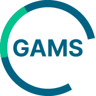

# GAMS Standards for Claude — v1.1.6

Work with the open asset-management standards on GAMS Standards — DDQs, fund data definitions, regulatory questionnaires, prospectus templates — straight from your AI assistant, read-only.

Published by Global Asset Management Standards at https://open.gamstandards.com/use-with-ai and in
the GAMS repository https://github.com/gamstandards/ai-plugins. If you downloaded a zip, compare the SHA-256
shown on that page with your file before installing.

## Install
1. Download the zip — no need to unzip it
2. In the Claude desktop app open Customise → Plugins, click Add plugin and choose to upload a plugin file
3. Select the downloaded zip; the plugin appears in your personal plugins — make sure it is enabled
4. The first time Claude uses search or ask, a Connect card asks you to sign in with your GAMS account (optional; browsing and reading need no sign-in)
5. Claude Code instead: run `claude --plugin-dir ~/Downloads/gams-standards-claude-1.1.6.zip` (the zip loads directly; `--plugin-url` with the download link also works)

## What it gives you
- Connects the GAMS MCP server for you — no URL to paste
- A skill that tells Claude which tool to use, how to cite, and how to respect content licenses
- Reference sheets for every tool and REST endpoint, loaded only when needed

## Good to know
- Team and Enterprise admins can also roll the plugin out to everyone from the organisation settings.

## What it can and cannot do
Read-only access to published GAMS content; no secrets; optional sign-in for the
search and ask tools only. Full statement: SECURITY.md.

## What it sends, and where
- It runs no code on your device: the package is instructions, reference sheets,
  manifests and an icon.
- Your assistant calls one server, https://open.gamstandards.com/mcp (HTTPS). It sends the tool calls
  your assistant makes: collection, group and item ids, search queries and the
  questions you ask about the standards.
- If you sign in for search and ask, sign-in goes through the GAMS authorization
  server listed at https://open.gamstandards.com/.well-known/oauth-protected-resource/mcp, using
  OAuth with PKCE. GAMS then sees which account made those calls.
- Your own documents are never uploaded by this package. Privacy notice:
  https://open.gamstandards.com/privacy.

## Links
- Setup guides and updates: https://open.gamstandards.com/use-with-ai
- MCP server: https://open.gamstandards.com/mcp
- API index: https://open.gamstandards.com/api/ai
- Guide for LLM tools: https://open.gamstandards.com/llms.txt

GAMS Standards is built and run on Alis Build (https://alisx.com/build).
